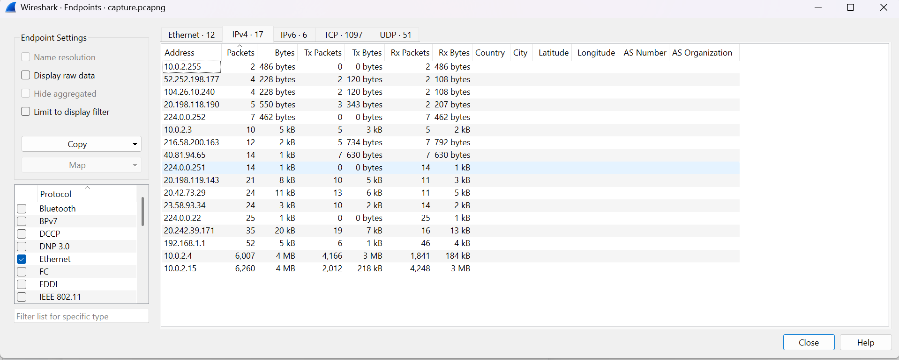
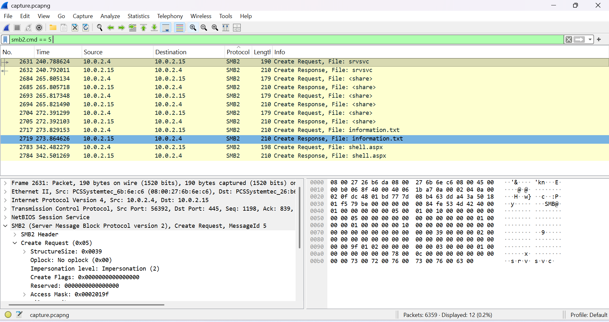
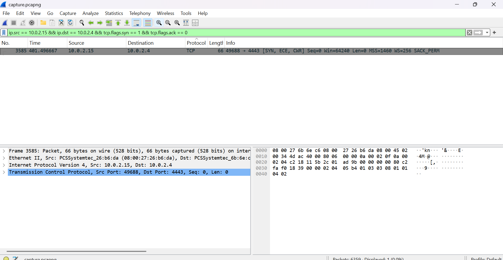
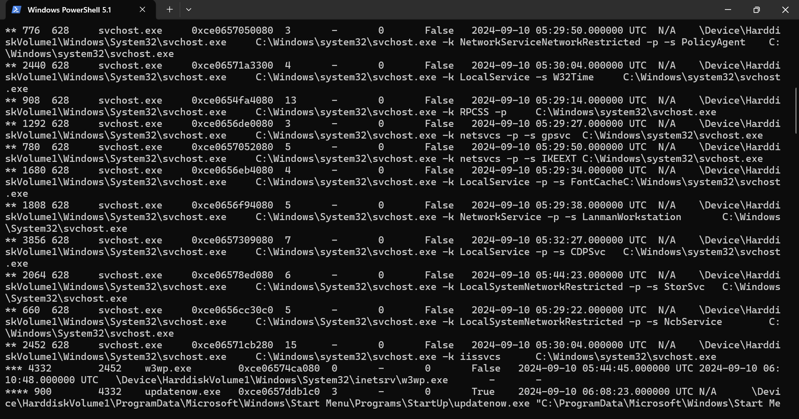
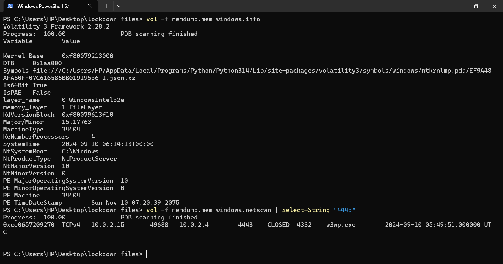
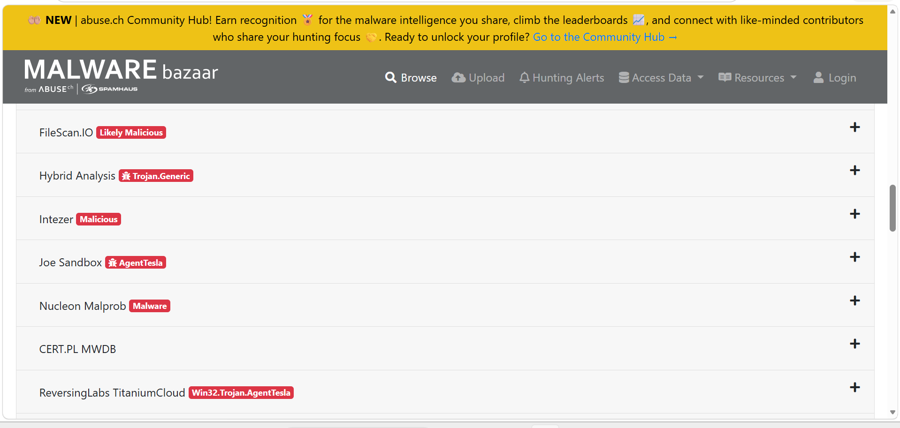

# DFIR Case Study: IIS Web Shell Intrusion & AgentTesla Persistence

## Overview
This repository presents a full-scope Digital Forensics and Incident Response (DFIR) investigation conducted on a compromised public-facing Windows IIS web server belonging to **TechNova Systems** (based on the CyberDefenders *Lockdown* scenario). By correlating network packet captures (PCAP), volatile memory dumps (RAM), and static malware triage, this investigation reconstructed the complete attack chain- from initial HTTP/SMB reconnaissance to web shell deployment, reverse shell execution, and persistent **AgentTesla** infostealer installation.

* **Affected Infrastructure:** TechNova Systems IIS Web Server (`10.0.2.15`)
* **Threat Actor Origin:** `10.0.2.4`
* **Malware Family:** AgentTesla (UPX-packed `.NET` payload)
* **Tools Used:** Wireshark, Volatility 3, PowerShell (`Get-FileHash`), VirusTotal / MalwareBazaar, MITRE ATT&CK Framework

---

## Documentation Guide
Explore the full technical and executive documentation inside the `docs/` directory:

* [** Project Overview**](docs/project-overview.md) - Incident scope, evidence integrity hashes, and network topology.
* [** Attack Investigation & Reconstruction**](docs/attack-investigation-and-reconstruction.md) - Chronological reconstruction across PCAP, memory, and disk artifacts.
* [** MITRE ATT&CK Mapping**](docs/mitre-attack-mapping.md) - Full mapping of adversary tactics, techniques, and sub-techniques.
* [** Executive Report (TechNova Leadership)**](docs/executive-report.md) - Non-technical briefing on business risk, impact, and strategic remediation.
* [** Technical Incident Summary (TechNova IT & Security)**](docs/incident-summary.md) - Engineering handoff with extracted IoCs, PIDs, and network signatures.
* [** Containment & Response**](docs/containment-and-response.md) - Step-by-step eradication, host isolation, and credential rotation procedures.
* [** Lessons Learned**](docs/lessons-learned.md) - Root cause analysis and long-term architectural hardening controls.

---

## Visual Evidence & Forensic Walkthrough

### 1. Network Reconnaissance & HTTP Enumeration (`Wireshark`)
Statistical endpoint analysis and HTTP stream inspection revealed high-volume reconnaissance probes originating from `10.0.2.4` using the **Nmap Scripting Engine (NSE)** against `10.0.2.15`.

### 2. SMB Share Enumeration & Web Shell Upload (`Wireshark`)
SMB2 protocol analysis (`smb2.cmd == 3` and `smb2.cmd == 5`) exposed unauthorized Tree Connect access to `\\10.0.2.15\IPC$` and `\\10.0.2.15\Documents`, followed by the upload of a malicious ASPX web shell (`shell.aspx`).

### 3. Outbound Reverse Shell Callback (`Wireshark`)
Following web shell execution, the IIS server (`10.0.2.15`) initiated an outbound TCP reverse shell connection back to `10.0.2.4` over non-standard port **`4443`**.

### 4. Volatile Memory Process Tree & Persistence (`Volatility 3`)
Inspecting the RAM image (`windows.info` / `windows.pstree`, Kernel Base `0xf80079213000`) confirmed that the IIS worker process (`w3wp.exe`, PID `4332`) spawned an unauthorized persistence binary (`updatenow.exe`, PID `900`) inside the global Windows `StartUp` directory.

### 5. Network Socket Attribution in Memory (`Volatility 3`)
Cross-referencing active/closed sockets via `windows.netscan` linked the outbound connection (`10.0.2.15:49688` to `10.0.2.4:4443`) directly to **`w3wp.exe` (PID `4332`)**.

### 6. Malware Hashing & Threat Intelligence Attribution
Computing the SHA-256 hash (`C25A6673A24D169DE1BB399D226C12CDC666E0FA534149FC9FA7896EE61D406F`) and querying threat intelligence databases identified `updatenow.exe` as a **UPX-packed AgentTesla** infostealer beaconing to **`cp8nl.hyperhost.ua`**.

